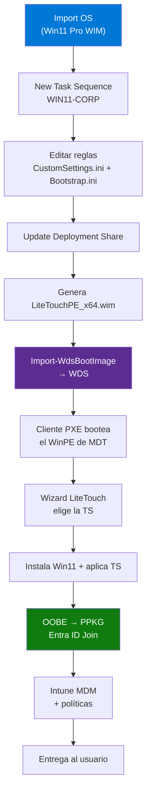
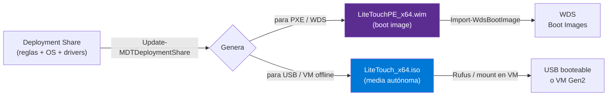
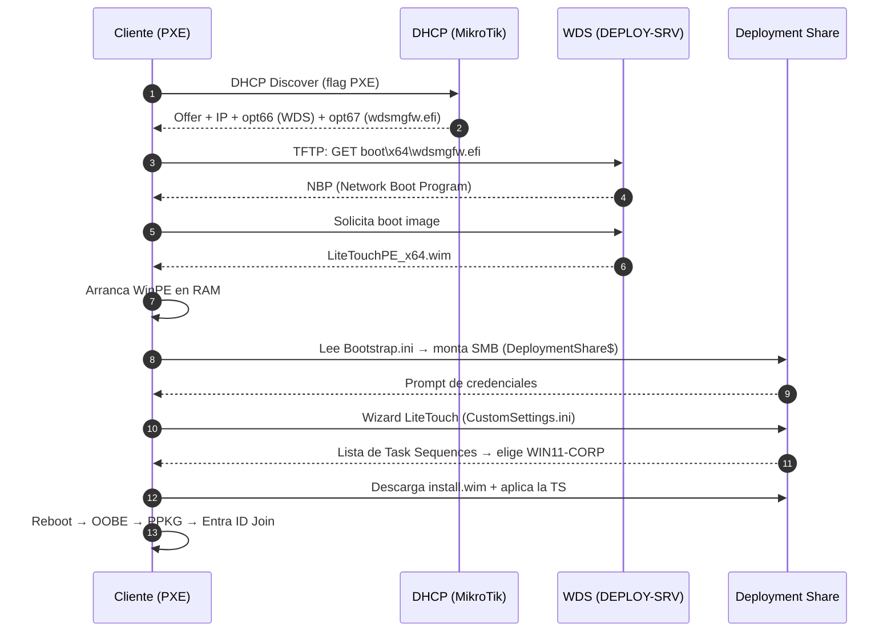

# Zero-Touch Windows 11 Imaging — MDT + WDS (Cloud-Only, Sin AD)

> Case study de un pipeline de masterización de Windows 11 Pro con **Microsoft Deployment Toolkit + WDS/PXE** para una organización **100% cloud (Entra ID + Intune), sin Active Directory on-premises**.


> [!NOTE]
> Repositorio de muestra. Nombres de host, IPs y la topología son **ilustrativos**; la infraestructura real está anonimizada.

## El problema

Masterizar equipos Windows 11 nuevos a escala en una organización **sin domain controllers**. El clásico MDT asume Active Directory (domain join, cuentas de servicio de dominio, OUs). Acá la identidad es **cloud-only**: hay que desacoplar el imaging del dominio y resolver la identidad *después*, con Entra ID Join + enrolamiento en Intune.

## Solución — arquitectura

```
LAN de clientes 10.0.0.0/24          Segmento de servidores (aislado)
        │                                     │
   [ cliente PXE ] ──── MikroTik ─────────────┤  (interface dedicada)
                        regla de acceso         │
                        inter-segmento          └── DEPLOY-SRV
                                                    ├─ MDT 8456 + Windows ADK
                                                    ├─ WDS (PXE, RemoteInstall)
                                                    └─ DHCP con opciones PXE
                                                       next-server → DEPLOY-SRV
                                                       opt 66/67
```

El servidor de deployment vive en un **segmento aislado**. El cliente arranca por red (PXE), WDS entrega el WinPE de MDT, un wizard selecciona la Task Sequence y se instala el SO.

## Componentes

| Componente | Rol |
|------------|-----|
| MDT 8456 | Orquestación de Task Sequences |
| Windows ADK | WinPE, DISM, herramientas de deploy |
| WDS | Servidor PXE (standalone, responde a todos los clientes) |
| DHCP | Entrega IP + opciones PXE (66/67) en el segmento |
| MikroTik (router de borde) | Routing + regla de acceso al segmento de servidores |

## Flujo end-to-end

De construir la imagen a entregar el equipo:



---

## 1. Armado de la Task Sequence (Deployment Workbench)

El Deployment Workbench es la consola de MDT. El orden importa: **primero el SO, después la TS que lo referencia.**

1. **Deployment Shares → New Deployment Share** → crea la estructura en disco (`Control\`, `Operating Systems\`, `Out-of-Box Drivers\`, `Boot\`).
2. **Operating Systems → Import Operating System** → *full set of source files* apuntando a los `sources\` del ISO montado de Win11 Pro. Importa el `install.wim` con todos sus edition indexes.
3. **Task Sequences → New Task Sequence:**
   - **Task sequence ID:** `WIN11-CORP` (este ID es la carpeta en `Control\` — no renombrar a mano después).
   - **Template:** *Standard Client Task Sequence*.
   - **OS:** el índice "Windows 11 Pro" importado en el paso 2.
4. **Editar la TS** (doble clic → pestaña *Task Sequence*) para el escenario cloud-only:
   - En **State Restore → Recover From Domain**, dejar el join en **WORKGROUP** (no hay dominio al que unirse).
   - Agregar un paso **Run Command Line** / *Install Application* para aplicar el **PPKG** (Entra ID Join) — o dejarlo para OOBE (ver etapa 2 del pipeline).

> [!IMPORTANT]
> El índice `Control\TaskSequences.xml` **no se edita a mano**. El provider lo parsea sin tirar error pero no enumera entradas con el mínimo defecto de formato. Para scriptarlo: `New-PSDrive` (MDTProvider) → `Import-MDTTaskSequence` → **`Remove-PSDrive` para flushear a disco** → verificar en proceso nuevo.

### Reglas: `CustomSettings.ini` y `Bootstrap.ini`

Las reglas controlan qué paneles del wizard se saltan y qué valores se pre-cargan. Viven en `Control\` del deployment share.

**`Bootstrap.ini`** — lo que WinPE lee *antes* de conectar al share (cómo encontrar y montar el share):

```ini
[Settings]
Priority=Default

[Default]
DeployRoot=\\DEPLOY-SRV\DeploymentShare$
; Dejar vacío para que WinPE pida credenciales en el prompt (más seguro
; que hardcodear una cuenta de servicio en texto plano):
SkipBDDWelcome=YES
```

**`CustomSettings.ini`** — lo que se evalúa una vez montado el share (automatiza el wizard):

```ini
[Settings]
Priority=Default

[Default]
_SMSTSOrgName=Corp IT - Windows 11 Imaging
OSInstall=Y
; --- Cloud-only: nada de dominio ---
JoinWorkgroup=WORKGROUP
SkipDomainMembership=YES
; --- Saltar paneles del wizard ---
SkipComputerName=NO          ; <- este SÍ lo mostramos (nombre del equipo)
SkipTaskSequence=NO          ; <- este SÍ (elección de la TS)
SkipAdminPassword=YES
SkipProductKey=YES
SkipLocaleSelection=YES
SkipTimeZone=YES
SkipUserData=YES
SkipSummary=YES
SkipFinalSummary=YES
TimeZoneName=Argentina Standard Time
KeyboardLocale=es-AR
FinishAction=REBOOT
```

> [!TIP]
> Cada `SkipXxx=YES` que agregás tiene que tener su valor pre-seteado en el mismo INI, o el deploy se cuelga pidiendo ese dato sin panel donde ingresarlo. Es el error #1 al endurecer el wizard.

---

## 2. Configuración de WDS

WDS es **solo el transporte PXE/TFTP**: entrega el WinPE de MDT por red. No tiene la lógica de deployment (esa está en el share).

```powershell
# Instalar el rol (Transport + Deployment server)
Install-WindowsFeature -Name WDS -IncludeManagementTools

# Inicializar en modo STANDALONE (no AD-integrated: no hay dominio)
wdsutil /Initialize-Server /Standalone /RemInst:"C:\RemoteInstall"

# Responder a TODOS los clientes (conocidos y desconocidos),
# sin aprobación manual de equipos nuevos
wdsutil /Set-Server /AnswerClients:All
```

### DHCP cuando no vive en el server de WDS

En este diseño el **DHCP corre en el router (MikroTik), no en el server de WDS**. Eso cambia qué opciones hay que setear:

| Opción DHCP | Valor | Cuándo |
|-------------|-------|--------|
| **66** (next-server) | IP de `DEPLOY-SRV` | Siempre (apunta al TFTP de WDS) |
| **67** (bootfile) | `boot\x64\wdsmgfw.efi` | Clientes **UEFI x64** |
| **67** (bootfile) | `boot\x64\pxeboot.n12` | Clientes legacy **BIOS** |
| **60** (`PXEClient`) | — | **Solo** si DHCP y WDS comparten host |

> [!NOTE]
> La opción **60 (`PXEClient`)** es una fuente clásica de confusión: solo hace falta cuando DHCP **y** WDS están en la **misma** máquina, para que el cliente sepa que el PXE está en otro puerto del mismo host. Con DHCP en el router y WDS aparte, **no se setea** — alcanza con 66 + 67.

En RouterOS (DHCP del segmento):

```routeros
/ip dhcp-server network
set [find comment="segmento-servidores"] \
    next-server=<IP-DEPLOY-SRV> \
    boot-file-name="boot/x64/wdsmgfw.efi"
```

---

## 3. "Importar la ISO a WDS" — la corrección técnica

Esto suele confundirse, así que vale aclararlo: **WDS no bootea una ISO. WDS network-bootea un boot image en formato `.wim`.** La ISO y el WIM son dos salidas distintas del mismo deployment share:



- El **`.wim`** (`DeploymentShare\Boot\LiteTouchPE_x64.wim`) es lo que se importa a WDS para arranque por red.
- La **`.iso`** es la *media* para boot offline (USB o VM sin red) — **no** se importa a WDS.

Cada vez que cambiás reglas, drivers o la TS, hay que **regenerar** el boot image y **re-importarlo**:

```powershell
# 1. Regenerar el boot image desde el deployment share (requiere elevación/DISM)
#    -Force recompila el WinPE con los cambios de reglas y drivers
Update-MDTDeploymentShare -Path "DS:\" -Force

# 2. Importar el boot WIM a WDS
Import-WdsBootImage `
    -Path "C:\DeploymentShare\Boot\LiteTouchPE_x64.wim" `
    -NewImageName "MDT LiteTouch x64 - Win11 Corp" `
    -NewDescription "WinPE de MDT para despliegue PXE"

# 3. Verificar que quedó registrado y es el default
Get-WdsBootImage -Architecture x64
```

> [!WARNING]
> Un WDS recién inicializado tiene **0 boot images**. Setear un "default boot image" **no** registra el WIM: hay que importarlo explícitamente con `Import-WdsBootImage` (o desde la consola → *Boot Images → Add Boot Image*), o el cliente arranca el TFTP pero se queda sin WinPE que cargar.

---

## El PXE boot, paso a paso

El handshake completo desde que el cliente enciende hasta que aparece el wizard:



---

## El desafío interesante: dual-WAN rompía el PXE

El router corría **policy-routing dual-WAN con PCC** (balanceo entre dos proveedores). Efecto colateral: el tráfico **entre segmentos internos** quedaba marcado por las reglas PCC y se enrutaba **hacia el WAN** en vez de quedarse en la LAN → se fugaba a internet y el cliente nunca alcanzaba al server.

**Diagnóstico:** las reglas mangle PCC usaban `dst-address-type=!local`, que no distingue "otra red interna" de "internet".

**Fix:** una regla `accept` en `prerouting` que corta el tráfico inter-segmento **antes** de que lo evalúen las PCC:

```routeros
/ip firewall mangle
add chain=prerouting action=accept \
    src-address=<LAN> dst-address=<segmento-servidores> \
    place-before=0 comment="Trafico interno: no balancear entre WANs"
```

Lección: el orden de las reglas mangle es todo. El tráfico interno nunca debería balancearse entre WANs.

---

## Pipeline de identidad (post-imaging, 6 etapas)

> [!IMPORTANT]
> Sin Active Directory: **no** hay `JoinDomain`, `DomainAdmin` ni `MachineObjectOU`. La cuenta de servicio de MDT es una cuenta **local** del Windows Server.

1. **Imaging** — MDT + WDS + PXE instala Windows 11 Pro.
2. **PPKG** — Provisioning package (Windows Configuration Designer) con bulk enrollment token → **Entra ID Join** automático en OOBE.
3. **MDM Enrollment** — Enrola en Intune vía cuenta admin del tenant, **sin** consumir licencia Intune del usuario final.
4. **Sync de políticas** — BitLocker (clave en Entra ID), Windows Hello for Business, Compliance, Update Rings, Defender.
5. **Apps** — IntuneWin32 vía Intune + PSADT.
6. **Entrega** al usuario final.

## Media offline para testing en VM

Para validar sin tocar la red de producción se genera una **Media MDT autónoma**: una ISO self-contained (Win11 Pro + Task Sequence embebidos) que bootea en una VM Gen2 (UEFI + Secure Boot + TPM) **sin conexión de red** y se auto-configura.

> [!WARNING]
> La Media usa **sus propias** reglas (`Content\Deploy\Control\CustomSettings.ini` y `Bootstrap.ini`), no las del deployment share — sin credenciales de red ni `DeployRoot`, porque se auto-localiza. `Update-MDTMedia` las preserva si ya existen.

<details>
<summary>Administración remota con WinRM cerrado</summary>

Cuando WinRM (5985) y DCOM (135) están cerrados en el firewall del server, el canal confiable es **PsExec** corriendo como SYSTEM (`-s`), que reutiliza la sesión SMB ya autenticada en vez de pedir un logon interactivo. La lógica va en un `.ps1` ejecutado por ruta y la salida se lee por SMB.

</details>

## Stack / Skills demostradas

`MDT 8456` · `Windows ADK / WinPE / DISM` · `WDS + PXE / TFTP` · `DHCP (opt 66/67)` · `MikroTik RouterOS (mangle, PCC, policy-routing)` · `Entra ID Join` · `Intune / MDM` · `PowerShell` · `Windows Configuration Designer (PPKG)` · `BitLocker` · `Windows Hello for Business`

## Roadmap

- [x] PXE del deployment share funcionando end-to-end
- [x] Media offline autónoma para VM
- [x] Resuelto el routing inter-segmento con dual-WAN
- [ ] Automatizar PPKG + MDM enrollment dentro de la Task Sequence
- [ ] Auto-incremento secuencial del nombre de equipo
- [ ] Inyección de drivers por modelo

## Licencia

MIT
